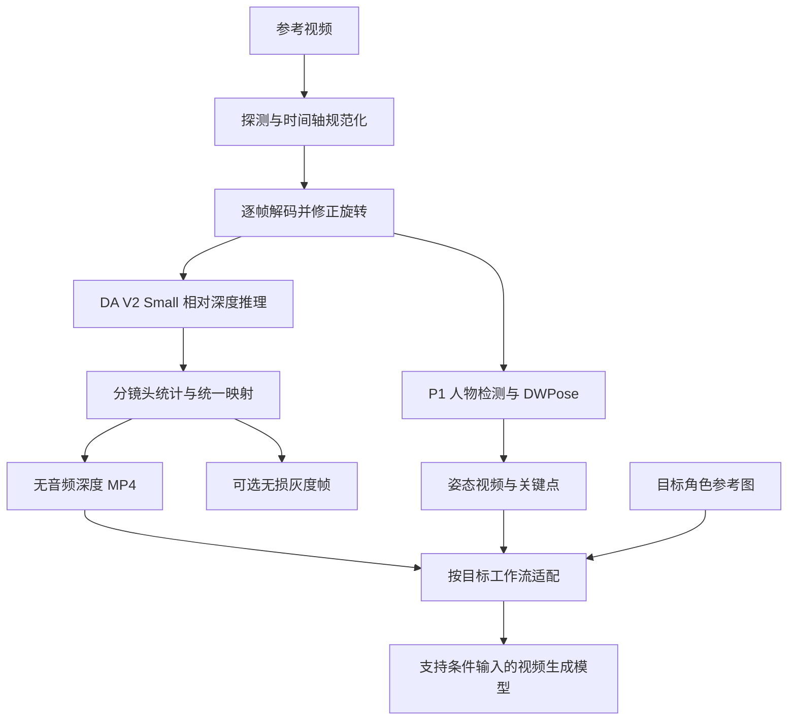

# 07 · 动作迁移用深度视频：本地技术方案

日期：2026-09-15。目标环境：本机 Apple M2 / 24 GiB 统一内存。

> **结论：将项目定位为“动作迁移控制素材生成器”。首版默认输出无音频的相对深度 MP4；先用 Depth Anything V2 Small 跑通本地流程，再依据动作迁移效果补充姿态骨架与时间一致性。**
>
> 深度素材解决“如何表达参考动作和空间结构”，最终的新人物视频由支持相应条件输入的生成模型完成。本方案不把深度估计等同于完整动作迁移，也不要求恢复米制真实距离。

本文为实施前的技术方案。深度环境和样本现已落地，实测与实现差异见 [08 · 深度环境与样本效果](08-深度环境与样本效果.md)；下游动作迁移生成仍未验证。

## 1. 从目的推导需要保留的信息

### 1.1 用户真正要迁移的是什么

例如：参考视频中的人物抬手、转身、靠近镜头，希望换成指定角色后仍然保持动作节奏与空间关系。

输入画面混合了多种因素：

```text
参考画面 = 人体姿态 + 运动时序 + 场景几何 + 摄像机运动
         + 原人物长相/服装纹理 + 材质 + 光照
```

动作迁移需要保留前四类中的必要部分，尽量降低原人物外观对目标角色的干扰。目标人物身份、服装和风格主要来自新的参考图或提示词。

这不是精确的图像分解公式，而是用于选择控制信号的工程思路。

### 1.2 为什么普通灰度视频不够

灰度化只去掉颜色，仍保留头发纹理、服装图案、皮肤亮度、阴影等外观信息。深色衣服不会因为离镜头近，就自动变白。

深度估计则尝试用一个像素场表达空间远近；它能降低纹理和照明的影响，更适合给生成模型施加几何约束。不过深度仍然保留体形、发型轮廓、衣服体积和部分模型误差，不能视为“彻底去掉身份”。

### 1.3 深度、姿态和遮罩各司其职

| 信号 | 主要保留什么 | 缺什么 / 可能的副作用 |
| --- | --- | --- |
| 相对深度 | 人物轮廓、身体体积、前后层次、遮挡关系 | 不显式标识左右关节；会带入原人物体形和背景结构 |
| 人体姿态 | 肩肘腕、髋膝踝等关节位置及其变化 | 骨架之外的衣摆、物体、体积和遮挡信息较弱 |
| 人物遮罩 | 主体活动范围和与背景的分离 | 单独使用不能表达内部姿态或距离 |
| 光流 | 像素运动与对应关系 | 也会包含相机运动、背景和外观变化；不等于骨架动作 |
| 目标角色参考图 | 新人物身份、服装和风格 | 单张图通常不提供完整动作时间轴 |

**推导：动作迁移应优先验证“姿态是否准确”；深度用于补充形体、接触和遮挡。** 对大幅换体型或换服装的任务，深度约束过强反而可能妨碍生成目标角色。

本项目先交付用户明确要求的 depth-only 素材，同时将 pose 与 mask 设计为独立输出。不能把三者任意混合成一张图后，假设所有下游模型都能识别。

## 2. 对此前“真实距离”的纠正

既然用途已经明确为 Motion Transfer，当前不需要知道“这个像素离相机 1.7 米”。需要的是同一动作序列中，手臂在身体前面、人物向镜头靠近等关系是否稳定。

因此采用：

- **相对深度**，不是测量级米制深度。
- 默认**近白远黑**，但由下游配置决定是否反转；模型原始输出可能是逆深度类相对量，必须验证方向。
- 默认**无音轨**。动作节奏依赖帧时间戳，去音频不等于改变播放速度。
- 输出既可用于观看，也可作为模型控制输入；不宣称兼容所有“视频参考”接口。

若将来转向三维测量，再独立设计 metric-depth、单位、相机参数和校准流程；它们不进入本次 MVP。

## 3. 本地可行性：已知事实和待验证项

本次读取本机环境得到：

| 项目 | 已确认状态 |
| --- | --- |
| 机器 | `Mac14,15`，处理器 Apple M2 |
| 统一内存 | 25,769,803,776 字节，即 24 GiB |
| Python | 项目 `.venv`，Python 3.12 系列 |
| PyTorch | 2.14.0，`torch.backends.mps.is_available()` 返回 true |
| Python 依赖 | transformers 4.57.6、PyAV 16.1.0、NumPy、Pillow 已安装并可导入 |
| 视频处理 | 原生 FFmpeg、ffprobe、网页/CLI、串行批量队列已可运行 |
| 当前指定样本 | 640 × 1152，24 fps，107 帧，约 4.458 秒，SDR |
| 深度模型 | 尚未下载权重，尚无本机深度推理基准 |

工程判断：**本机适合做小模型、batch=1、流式解码的深度/姿态预处理。** 这不代表 MPS 已能运行所有候选模型算子，也不代表能舒适运行大型视频生成模型。

MPS 与 CPU、系统和浏览器共享统一内存。VideoToolbox 只加速视频编码，不加速深度网络；切换“快速编码”不能直接解决深度推理慢的问题。

## 4. 推荐技术路线与模型选择

### 4.1 首版基线：Depth Anything V2 Small

选择官方 Hugging Face 转换版本：`depth-anything/Depth-Anything-V2-Small-hf`，通过现有 Transformers/PyTorch 环境加载。

- 原项目 Small 为约 24.8M 参数的相对深度模型，官方示例包含 MPS 设备选择。
- HF 格式便于锁定模型 revision、处理器配置和 safetensors 权重。
- 适合先建立逐帧基线；**图像模型不提供原生视频时间一致性保证**。

来源：[官方项目](https://github.com/DepthAnything/Depth-Anything-V2)、[官方 HF 模型](https://huggingface.co/depth-anything/Depth-Anything-V2-Small-hf)。

先以 FP32、MPS、batch=1 验证数值；不把半精度作为未测试的默认优化。MPS 不支持的算子应给出原因，并允许用户选择 CPU 重试，不暗中把整批作业退到极慢路径。

### 4.2 时间一致性升级：Video Depth Anything Small

将其列为质量升级候选，而非第一天就取代简单基线：它专门处理视频的时间一致性，但整套推理管线更复杂。

已核对的关键条件：

- 官方 `run.py` 当前设备选择为 CUDA 或 CPU，没有自动选择 MPS。
- 官方离线核心按 32 帧窗口与重叠机制处理，不应随意缩成 4/8 帧以节省内存。
- 公开性能表来自 A100，不能用来预测这台 M2 的速度或内存。
- 实验性流式方案存在效果取舍，不因其“streaming”名称就作为默认高质量路线。

来源：[项目说明](https://github.com/DepthAnything/Video-Depth-Anything)、[官方入口](https://github.com/DepthAnything/Video-Depth-Anything/blob/main/run.py)、[窗口推理代码](https://github.com/DepthAnything/Video-Depth-Anything/blob/main/video_depth_anything/video_depth.py)。

接入门槛：先做 MPS 算子、精度、一个官方窗口的内存验证；再验证重叠接缝。若需要大量 CUDA 专属改写或内存不可接受，保留 DA V2 Small，继续优化姿态信号，而不是为了模型名称扩大工程范围。

### 4.3 动作表达升级：DWPose

当目标是跟随人体动作，P1 增加 DWPose 骨架视频与原始关键点 JSON。官方提供 ONNX 路线，可避免直接引入完整训练框架。

建议先验证 ONNX CPU 推理，再考虑其他加速后端；不能把 PyTorch MPS 可用等同于 ONNX 自动使用 MPS。还要计入人体检测器的依赖和成本，不能只部署姿态网络。

来源：[DWPose 官方说明](https://github.com/IDEA-Research/DWPose)。

骨架必须匹配目标工作流的关节编号、连线与颜色约定。多人场景先选定并跟踪同一个主体，不按每帧检测顺序更换人物。低置信关键点不强行绘制，短缺失可插值，长遮挡需提示，不能伪造连续动作。

### 4.4 本次不作为默认路线

| 路线 | 不优先的原因 |
| --- | --- |
| 米制深度估计 | 当前目标并不需要米值，不能替代姿态和时序约束 |
| 大型扩散式深度模型 | 在本机增加推理和部署负担，先证明小模型不足再评估 |
| 一开始就使用大型视频生成模型 | 与控制素材预处理属于不同资源层级，本机端到端体验未验证 |
| 手工滤镜伪造深度 | 灰度、边缘、模糊不是深度估计 |
| 直接强时间均值滤波 | 可能产生拖影、压平快速动作，改善“平滑”却损伤迁移效果 |

## 5. 完整处理流程



### 步骤 A：输入探测和时间轴

复用 ffprobe 与现有根目录授权机制，拒绝网络 URL；首版继续限定 SDR。

- 确认主视频流、显示方向、像素宽高比、时长、帧时间戳和帧率。
- 恒定帧率素材默认保持原 fps；当前样本应保持 24 fps、107 帧。
- VFR 不能简单拿“平均帧率”重新封装。先建立源 PTS 到目标时间格点的映射，再统一采样；UI 显示帧率变化，manifest 记录重复/丢弃帧。
- 默认不猜测目标模型的 16/24/30 fps。VFR 首版可要求用户显式选择 `--fps`，而非默默改速。
- 相机运动默认保留，不自动稳定镜头；去掉相机运动是另一个需要显式设置的目标。

### 步骤 B：预处理与逐帧推理

- 使用 PyAV 解码；显式处理旋转和显示比例，不能假设 PyAV 与 FFmpeg CLI 的自动旋转行为相同。
- 预处理遵守模型处理器的归一化和长宽比约定，禁止强行把竖视频压成正方形。
- 默认推理短边 392（14 的倍数），由处理器计算实际形状；记录实际张量宽高。设置长边保护，超出时采用有记录的等比缩放/补边。
- 单帧 FP32 推理；深度结果插值回统一输出画布。提高最终输出分辨率不代表恢复了更多模型细节。
- 模型只加载一次，批次内复用；不为每帧重启 Python 或重复加载权重。
- 默认每个输出时刻实际推理，不默认“每隔几帧推理再插值”，避免抹掉快速手部动作。

### 步骤 C：深度值映射与时序稳定

模型输出记为 `q_t(x,y)`，它是相对量，不能直接标成米。目标是把序列映射为约定一致的灰度控制信号。

**首版使用两遍处理：**

1. 第一遍推理，将每帧原始相对深度分块缓存到磁盘，并以有界采样方式统计每个镜头的 2%/98% 分位数。
2. 第二遍使用同一个镜头的固定范围映射：`g = clip((q - low) / (high - low + epsilon), 0, 1)`。
3. 按已验证的输出方向保留 `g` 或使用 `1-g`；默认交付近白远黑。
4. 识别镜头切换后重置范围，不跨切镜平滑。低动态范围镜头给出诊断，不放大数值噪声。

固定范围可减少**逐帧 min/max 拉伸引入的闪烁**，但不能消除单帧网络自身的尺度/形状漂移。它是归一化策略，不是完整视频一致性算法。黑色补边不参与统计，人物裁剪/遮罩启用时明确统计范围。

若实测仍有明显漂移，优先 A/B 比较视频深度模型。可另试基于运动对应、遮挡掩码与稳健拟合的尺度对齐；未经运动补偿，不直接对前后帧深度做大权重 EMA。快速运动、遮挡和切镜时应降低或关闭平滑。

### 步骤 D：人物区域与背景

首版默认输出全画幅，避免引入不准确抠图；P1 提供主体遮罩作为单独产物。

- 替换背景时，深度中保留的原背景几何可能构成过强限制。
- 换体型、换宽松服装时，原人物外轮廓可能与新角色冲突。
- 裁剪应使用固定或平滑变化的主体区域，记录所有坐标变换；不要每帧跳动裁切。
- 下游如支持遮罩，可分别控制人物与背景；不默认把 mask 乘到 depth 上导致边缘突变。

### 步骤 E：编码与发布

默认 `depth.mp4`：H.264 / yuv420p、无音轨、无伪彩、不附原图、不加文字或水印。视频帧只包含一张深度图，不能用左右对比画面代替控制素材。

以 libx264 CRF 18 作为待验证起点，编码参数和范围均写入 manifest。灰度深度经过有损压缩不再是精确数值数据；精细边缘或下游需要无损输入时，另导出 PNG 序列。

编码前后解码对照，检查灰阶映射和 full/limited range，不能只检查容器标签。也不能用普通 RGB 观看截图反推物理距离。

## 6. 输出契约：保证下游能正确使用

建议每个任务生成一个独立目录：

```text
output/<name>-motion-<id>/
  depth.mp4                 # 默认，无音轨，仅深度帧
  manifest.json             # 时间轴、模型、预处理与映射
  depth-frames/             # 可选：16-bit PNG，仍是归一化相对值
  pose.mp4                  # P1：匹配下游约定的骨架渲染
  pose.json                 # P1：坐标、置信度、主体跟踪 ID
  mask.mp4                  # P1：可选主体遮罩
  preview.jpg               # 仅供人检查，不提交为模型控制输入
```

manifest 至少记录：

- schema 版本、源文件哈希、任务参数、模型 ID / revision / 权重哈希、设备和精度。
- 源/输出 fps、帧数、每帧 PTS、采样映射、起止范围、旋转与裁剪变换。
- `depth_kind=relative`、`near_is_white=true`、镜头分段、归一化分位数及实际 low/high。
- `audio=none`、输出画布和推理实际尺寸、编码器与 CRF、是否补边。
- 可选工作流名称与版本、输入方向/数值范围约定、验证是否通过。

不要将 float32 数组或 16-bit PNG 标成米值。默认不导出体积较大的原始深度缓存；需要调试时用显式开关保留。

## 7. 接入现有网页与 CLI

### 7.1 用户操作

默认设置应变为：

| 设置 | 默认 | 可选 |
| --- | --- | --- |
| 处理类型 | 深度视频（动作参考） | 普通灰度视频；P1 动作控制素材包 |
| 音频 | 无音频 | 显式保留音频 / AAC，兼容非控制用途 |
| 深度引擎 | 本地轻量 | 本地时序增强，达到验证门槛后开放 |
| 深度方向 | 近白远黑 | 反转；下游配置可覆盖 |
| 时间轴 | 保持源 CFR | 显式指定 fps，VFR 需确认采样策略 |
| 输出大小 | 保持原画布 | 指定尺寸，与下游保持一致 |

音频选项仍独立存在，但“动作控制素材包”应强制无音频并在 UI 标明。默认深度引擎缺失时，显示安装/下载入口，**不回退成普通灰度并宣称成功**。

拟定命令（尚未实现，不能按当前版本直接运行）：

```bash
# 下载并校验固定版本模型；只在这一步联网
node src/cli.js setup-depth

# 默认：相对深度 MP4，无音频
node src/cli.js convert reference.mp4

# 深度选项
node src/cli.js convert reference.mp4 --mode depth --depth-quality light --invert-depth

# 显式保留旧功能
node src/cli.js convert reference.mp4 --mode grayscale --audio auto

# 批量
node src/cli.js convert --input-dir ./test --recursive --mode depth

# P1 多信号素材包
node src/cli.js convert reference.mp4 --mode motion-pack --pose
```

初次下载显示来源、大小和进度，校验哈希。推理只加载本地固定权重，禁用远程代码执行和隐式在线补下载。公开分发时按具体模型版本记录许可证；Small 型号与更大型号的许可不能混用。

### 7.2 内部实现

继续复用 Node 文件授权、持久队列、取消、SSE 和结果页面。新增：

```text
src/core/depth.js            # 选项、Python worker 协议、产物校验
python/depth_worker.py       # 模型加载、解码、推理、归一化、缓存
python/depth_pipeline.py     # 时间轴、镜头分段与输出
.models/                    # 固定 revision 权重，Git 忽略
.grayscale/depth-cache/     # 分块缓存，Git 忽略
```

Node 和 Python 通过 JSON Lines 交换任务路径、参数、阶段和进度；不通过 HTTP 或 Base64 传整批图像。推荐先让 Python/PyAV 输出带时间戳的无损临时灰度视频，再由 Node 管理 FFmpeg 封装最终结果；所有子进程都纳入取消和退出清理。

进度分为模型加载、推理、归一化/编码、验证；没有准确时长时显示“已处理帧 / 总帧”，不把推理完成就标 100%。任务记录增加 mode、模型和映射参数。旧任务缺少 mode 时按 grayscale 迁移，避免重试旧任务时悄悄改成深度。

深度与灰度不共用同一套输出验证：前者检查方向、时序和结构；后者继续验证去色结果。最终仍应验证无音轨、可解码、尺寸和时间轴，并采用防覆盖发布。

## 8. M2 / 24 GiB 的资源约束

以下是**项目拟定预算与降级策略，不是已测性能**：

- 全局一个活跃重任务；深度、姿态按阶段串行执行，模型不用时释放。
- DA V2 Small 先以短边 392、batch=1、FP32 运行；质量不够再试 518。
- CPU + MPS + 缓存缓冲的应用总占用初始目标控制在约 10–12 GiB 内，给系统和浏览器留余量；RSS 与设备分配可能重叠，记录指标时说明口径，不能直接相加当作精确占用。
- 解码帧队列有上限；用磁盘分块缓存，不将整个视频的 RGB 和深度数组全部保存在 RAM。
- 当前样本若按原尺寸缓存 107 帧 float16 深度，约 150.5 MiB；float32 约 301 MiB。此计算只包含深度数组，不包含模型、激活、RGB 缓冲和文件开销。
- 未证明时序增强模式能满足预算前，不将其设为默认。不能通过篡改官方窗口长度宣称兼容。
- 过热或系统内存压力时暂停后续任务；下一次重试可显式减小推理尺寸。不要在一个已运行片段中途无提示改变质量。

首轮记录每帧平均/中位推理耗时、模型加载耗时、总墙钟耗时、峰值内存和缓存大小。107 帧总耗时应以实测为准，不用“视频只有 4 秒”推断它能几秒处理完。

## 9. 下游动作迁移：如何判断真正有用

可选择支持结构条件的视频生成工作流进行验收。Wan/VACE 提供深度、姿态等条件相关的预处理/编辑入口，是可研究的适配对象；不能将其支持某种控制输入，扩大为自动支持任意多路组合。

来源：[Wan2.1 官方说明](https://github.com/Wan-Video/Wan2.1)、[VACE 官方项目](https://github.com/ali-vilab/VACE)。

先选定一个具体工作流并记录模型、节点版本、帧率、画布尺寸、深度方向、参考图接入方式。如果接收端内部已经有深度预处理器，选择“使用已预处理条件”的路径，避免对 depth.mp4 再估计一次深度。

对于只提供“上传参考视频”的封闭接口，没有明确 depth 控制协议时，先做小样本验证；它可能把深度图当成普通黑白外观，不能默认兼容。

这台 M2 首阶段负责所有素材预处理。最终生成可由已有的兼容工作流执行；大型模型在本机完整运行需要单独验证，不作为本项目可用性的前提，也不自动上传用户素材到远端。

### 最小 A/B 实验

固定同一目标角色图、提示词、种子及生成设置；同一组种子重复比较：

1. 不使用动作控制，作为基线。
2. 仅深度控制。
3. 仅姿态控制（工作流支持时）。
4. 深度 + 姿态，只有工作流明确支持时测试。

评价动作关键时刻、左右肢体、手臂交叉、目标身份、背景泄漏和时序稳定。人体比例不同的目标角色，姿态误差应在归一化坐标/骨架尺度下比较，不能只按原始像素距离打分。

**验收成功应是目标角色更准确地复现参考动作，而不只是深度图看起来漂亮。**

## 10. 验收计划与实施顺序

| 阶段 | 工作 | 退出条件 |
| --- | --- | --- |
| A：样本深度闭环 | 固定 Small 权重；MPS 单帧与短序列；指定视频输出 | 无 NaN/Inf，实际近远方向经选点检查，107 帧、24 fps、零音轨 |
| B：时间轴与映射 | 镜头内固定范围、旋转/裁剪、PTS、manifest、无损对照 | 快速动作不被平滑掉，画布/时间轴对齐，切镜不串扰 |
| C：产品接入 | 默认 depth+mute；CLI/网页选项；进度、取消、缓存清理 | 缺模型明确失败；旧灰度任务重试不变；批量独立失败可恢复 |
| D：动作迁移验收 | 接一个明确支持 depth 的生成工作流 | 有固定条件的基线对照，动作跟随优于无控制，并记录失效情况 |
| E：增强 | Pose、mask、视频时序模型候选 | 根据 D 的具体失败样例提升结果，而非只增加模型数量 |

### 当前样本与补充素材

当前 `test/2026-09-15_153332_222.mp4` 用于端到端冒烟测试。它不足以覆盖所有动作类型，还需补充：全身抬手、转身/交叉遮挡、快速手势、镜头推拉、多人经过、静止镜头、切镜、低光与运动模糊。

### 客观检查

- ffprobe 确认**音轨数为 0**；完整解码无错误；帧数、fps、PTS 和 manifest 一致。
- 深度方向通过人工指定的近/远区域检查；不能把肤色亮度当成距离标签。
- 静态区域的时序波动需要先做对应关系或运动补偿；不能要求移动物体在固定像素位置数值不变。
- PNG/无损中间结果与 MP4 解码帧比较，检查压缩对轮廓和灰度范围的影响。
- 取消不留活跃推理子进程；源文件哈希不变；未完成缓存不作为最终结果。
- 20 个任务验证成功、错误隔离与重启恢复；长视频再测内存是否稳定，而非按帧数增长。

## 11. 最终决策

**现在做：相对深度、无音频、稳定时间轴、本地 Small 模型、网页/CLI 共用管线。**

**随后做：用实际动作迁移效果决定补姿态还是补视频时间一致性。**

不再因缺少米制距离而阻塞本次需求；同时不把“深度 MP4 已生成”当成完整动作迁移已完成。本项目的长期价值，是让参考动作以可复现、可检查、易被下游接收的结构信号交付。
